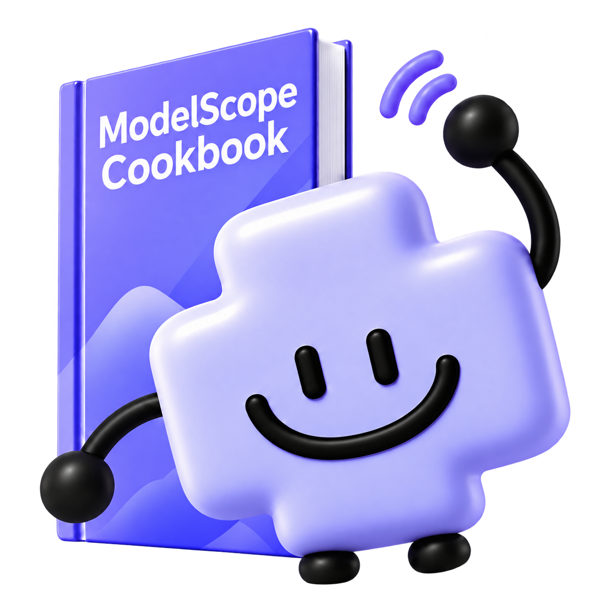

<p align="right"><a href="README_EN.md">English</a> · 简体中文</p>

<div align="center">
  
  <h1>ModelScope Cookbook · 魔搭紫皮书</h1>
  <h3>📖 开源模型应用实战指南</h3>
  <p>从跑通第一个模型，到构建自己的 AI 应用</p>
  <p><strong>选得对 · 跑得起 · 调得好 · 用得上</strong></p>
  <p>
    <a href="https://modelscope.cn/active/ms-cookbook"></a>
    <a href="https://github.com/modelscope/ms-cookbook/stargazers"></a>
    <a href="https://github.com/modelscope/ms-cookbook/network/members"></a>
    <a href="LICENSE"></a>
  </p>
  <p>
    <a href="#intro">项目介绍</a> ·
    <a href="#start">快速开始</a> ·
    <a href="#contents">内容导航</a> ·
    <a href="#learning">如何学习</a> ·
    <a href="#contribute">参与共建</a> ·
    <a href="#translate">英文翻译共建</a> ·
    <a href="#community">读者社区</a>
  </p>
</div>

---

<a id="intro"></a>

## 🎯 项目介绍

开源模型让越来越多的 AI 能力变得触手可及。但面对丰富的模型和工具，真正开始动手时，我们仍会遇到一连串问题：业务需求该选哪类模型？自己的电脑能不能跑？数据该怎么准备？微调之后效果有没有变好？怎样把模型接进一个实际应用？

**魔搭紫皮书是面向开发者的开源模型应用实战指南。** 我们从这些具体问题出发，把模型选型、推理部署、数据准备、微调评测与应用开发串成一条学习路线，并通过 RAG、Agent、AIGC 和端侧应用等案例，带你把方法用起来。

本书结合魔搭社区的模型与开发资源，以及 **EvalScope、ms-swift、DiffSynth、Ollama** 等工具，帮助你理解每一步为什么这样做、需要哪些条件，以及如何判断结果。你可以从第一个推理示例开始，也可以直接找到当前任务对应的章节，在复现和修改中积累自己的实践经验。

我们希望，这本书能陪你从“想试试开源模型”，走到“能用开源模型解决一个具体问题”。

<a id="start"></a>

## 📚 快速开始

### 在线阅读

**[📖 开始阅读魔搭紫皮书 →](https://modelscope.cn/active/ms-cookbook)** · [魔搭创空间入口](https://modelscope.cn/studios/ms-cookbook-team/ms-cookbook)

无需安装，打开即可阅读。阅读网站提供全文搜索、章节导航、学习路线和代码复制，方便你边看边实践。

### 本地阅读

如果你希望在本地阅读，或进一步参与项目共建，可以克隆仓库：

```bash
git clone https://github.com/modelscope/ms-cookbook.git
cd ms-cookbook
python3 -m http.server 4173 --bind 127.0.0.1
```

在浏览器打开 [http://127.0.0.1:4173/#home](http://127.0.0.1:4173/#home)。按 `Ctrl+C` 停止服务；如果端口被占用，可将命令和访问地址中的端口一并改为 `4174`。

阅读网站只需要 Python 3 和现代浏览器。运行各章的模型示例时，请按章节说明准备依赖、模型文件、访问凭据与算力资源。

### ✨ 你将收获什么？

- 🔍 **学会模型选型：** 把业务需求转成模型任务，结合模型卡、资源要求和评测结果做选择。
- 💻 **跑通开源模型：** 从魔搭 Notebook、Ollama 等入口开始，理解本地与云端推理、显存需求和量化方法。
- 🛠️ **动手微调与评测：** 整理训练数据，使用 ms-swift 开展轻量微调，并对比微调前后的效果。
- 🧩 **搭建应用流程：** 通过知识问答、语音助手、客服质检和手机巡检等案例，学习组合模型与业务流程。
- 🎨 **探索 AIGC 创作：** 实践图像 LoRA、商品图生成与编辑、教学海报制作，理解生成模型的基础知识。
- 🤖 **入门 Agent 开发：** 理解 Agent、MCP 与 Skill，结合开发工具和巡检案例探索任务执行与效果优化。

<a id="events"></a>

## 共建活动

<!-- events-preview:start -->
- **11.04 · 线上共学营**　[魔搭紫皮书共学营 Vol 4：小模型也能搞科研？4B参数也玩起了科学发现～用Qwen3搭建Mini AIScientist全流程，从提出假设到验证结论](content/events/README.md#aiscientist-20261104)
- **10.28 · 线上共学营**　[魔搭紫皮书共学营·AIGC 专场：从出图、改图到做漫剧：魔搭紫皮书 AIGC 解读与实战](content/events/README.md#aigc-20261028)
- **10.21 · 线上共学营**　[魔搭紫皮书共学营·进阶实践：模型跑通了，怎么变好用？  选型、评测、微调与企业知识问答实战](content/events/README.md#advanced-20261021)

[查看完整活动时间线 →](content/events/README.md)
<!-- events-preview:end -->

<a id="contents"></a>

## 📖 内容导航

全书按 **8 篇主题、39 个章节**组织，覆盖从认识模型到场景应用的学习过程。点击章节可在 GitHub 阅读正文，也可前往[在线阅读网站](https://modelscope.cn/active/ms-cookbook)。

**状态说明：** ✅ 可读 · 🚧 待更新 · 🤝 共建入口。共建入口用于征集案例或评测内容。

| 章节 | 关键内容 | 状态 |
| --- | --- | --- |
| **第一篇　认识开源模型** | | |
| [01 · 开源模型正在改变什么](content/chapters/chapter-01.md) | 开放程度、能力边界与许可证 | ✅ 可读 |
| [02 · 开源模型还没用上，先卡在下载这一步？](content/chapters/chapter-02.md) | 模型库检索、模型卡与下载方式 | ✅ 可读 |
| [03 · 数据，是你要做开源模型微调的基石](content/chapters/chapter-03.md) | 数据来源、质量与微调准备 | ✅ 可读 |
| [04 · 没有资源也能玩开源模型，因为这里资源免费](content/chapters/chapter-04.md) | 模型与算力资源入口 | ✅ 可读 |
| **第二篇　从问题出发：找到适合场景的开源模型** | | |
| [05 · 要把业务问题转换成模型任务问题](content/chapters/chapter-05.md) | 任务定义、输入输出与评估标准 | ✅ 可读 |
| [06 · 先评再选：用 EvalScope 形成开源模型的第一份报告](content/chapters/chapter-06.md) | 使用 EvalScope 建立选型基线 | ✅ 可读 |
| **第三篇　跑得起：让第一个开源模型工作起来** | | |
| [07 · 30 分钟带你快速看到第一个结果](content/chapters/chapter-07.md) | 完成首次模型推理 | ✅ 可读 |
| [08 · 多大模型，选择什么样的服务器配置](content/chapters/chapter-08.md) | 参数规模、显存与服务器选型 | ✅ 可读 |
| [09 · 笔记本也能跑开源模型，先从 Ollama 开始](content/chapters/chapter-09.md) | 使用 Ollama 开展本地推理 | ✅ 可读 |
| [10 · 把模型放到云端跑，用 Notebook 试试 CPU 和 GPU](content/chapters/chapter-10.md) | 在云端 Notebook 中运行模型 | ✅ 可读 |
| [11 · 把自己微调的 MiniCPM 装进手机：从训练拆解到魔搭实践](content/chapters/chapter-11.md) | LoRA 微调、GGUF 量化与 Android 手机部署 | ✅ 可读 |
| [12 · 模型需要资源太多，量化能帮上什么忙？](content/chapters/chapter-12.md) | 量化精度与资源开销 | ✅ 可读 |
| **第四篇　调得好：把通用模型变成场景模型** | | |
| [13 · 业务素材这么多，怎么变成能训练的数据？](content/chapters/chapter-13.md) | 从业务资料整理训练样本 | ✅ 可读 |
| [14 · 快速用 ms-swift，完成开源模型的轻量微调](content/chapters/chapter-14.md) | 使用 ms-swift 开展轻量微调 | ✅ 可读 |
| [15 · 模型已经会回答了，为什么还要做偏好对齐？](content/chapters/chapter-15.md) | 理解偏好对齐的目标与方法 | ✅ 可读 |
| [16 · 微调有没有用，测才知道？](content/chapters/chapter-16.md) | 对比微调前后的模型效果 | ✅ 可读 |
| **第五篇　场景篇：从模型走向完整业务系统** | | |
| [17 · AI 健身教练：跟着视频练，让 AI 指出动作不标准的地方](content/chapters/chapter-17.md) | 人体关键点与动作对比 | ✅ 可读 |
| [18 · 智能客服质检：AI 能从一通客服电话中分析出什么？](content/chapters/chapter-18.md) | 通话转写与服务质量分析 | ✅ 可读 |
| [19 · 搭建一个能听也能说的语音助手](content/chapters/chapter-19.md) | 串联语音识别、问答与合成 | ✅ 可读 |
| [20 · 实现一个企业知识问答助手](content/chapters/chapter-20.md) | 知识库检索与 RAG 问答 | ✅ 可读 |
| [21 · 用 MiniCPM-V 搭建手机巡检助手：拍照生成现场记录](content/chapters/chapter-21.md) | 端侧图像推理、人工确认与离线同步 | ✅ 可读 |
| [22 · 场景有千千万，欢迎你来共建出你的场景](content/chapters/chapter-22.md) | 可复现业务场景的共建邀请 | 🤝 共建入口 |
| **第六篇　AIGC 特別篇** | | |
| [23 · 10 个 Case，带你看看 AIGC 的开源模型能做到什么地步](content/chapters/chapter-23.md) | 开源生成模型的应用案例 | ✅ 可读 |
| [24 · 定制？使用 DiffSynth 训练图像 LoRA](content/chapters/chapter-24.md) | 使用 DiffSynth 定制图像 LoRA | ✅ 可读 |
| [25 · 一张商品营销图，从生成到修改怎么做？](content/chapters/chapter-25.md) | 商品图生成与编辑 | ✅ 可读 |
| [26 · 想要教学海报？要不试试让 AI 帮忙画一张](content/chapters/chapter-26.md) | Qwen-Image 本地部署与 ModelScope 教学海报生成 | ✅ 可读 |
| [27 · 开源模型也能做出像样的 AI 视频吗？](content/chapters/chapter-27.md) | 视频模型部署实践，正文待补充 | 🚧 待更新 |
| [28 · 补充：AIGC 理论知识](content/chapters/chapter-28.md) | 图像与视频生成基础 | ✅ 可读 |
| **第七篇　Agent 特别篇** | | |
| [29 · Agent 是什么，它能做什么事？](content/chapters/chapter-29.md) | Agent 的组成、执行流程与适用场景 | ✅ 可读 |
| [30 · MCP：让模型连接外部工具](content/chapters/chapter-30.md) | 连接模型与外部工具 | ✅ 可读 |
| [31 · Skill：把任务方法封装成能力](content/chapters/chapter-31.md) | 组织可复用的任务方法 | ✅ 可读 |
| [32 · 快速使用 Claude Code](content/chapters/chapter-32.md) | Claude Code 入门 | ✅ 可读 |
| [33 · 快速使用 PI](content/chapters/chapter-33.md) | PI 入门 | ✅ 可读 |
| [34 · 快速使用 DeepSeek Harness](content/chapters/chapter-34.md) | DeepSeek Harness 入门 | ✅ 可读 |
| [35 · 产线巡检 Agent：用 Penguin Harness 快速开发与优化](content/chapters/chapter-35.md) | 用 Penguin Harness 开发产线巡检 Agent，并通过评测优化 | ✅ 可读 |
| [36 · Mini AI Scientist：让 4B 开源模型自己做实验、发现隐藏规律](content/chapters/chapter-36.md) | 用 Qwen3 搭建可验证的科学发现 Agent，对比模型规模与思考模式 | ✅ 可读 |
| [37 · 补充：Agent 框架知识](content/chapters/chapter-37.md) | Agent 框架基础 | ✅ 可读 |
| **第八篇 补充内容** | | |
| [38 · 补充：大模型基础知识](content/chapters/chapter-38.md) | 模型结构、训练、推理与局限 | ✅ 可读 |
| [39 · 主流 LLM 评测](content/chapters/chapter-39.md) | 主流模型评测的共建邀请 | 🤝 共建入口 |

### 🚀 从一个具体案例开始

如果你已经有想做的方向，也可以先读案例，再回到相关章节补充基础。

| 我想做什么 | 可以从哪里开始 | 实践重点 |
| --- | --- | --- |
| 做一个能听也能说的助手 | [第 19 章 · 语音助手](content/chapters/chapter-19.md) | 串联语音识别、模型问答与语音合成 |
| 让模型回答企业资料中的问题 | [第 20 章 · 企业知识问答](content/chapters/chapter-20.md) | 知识检索与 RAG 问答 |
| 用手机拍照生成巡检记录 | [第 21 章 · 手机巡检助手](content/chapters/chapter-21.md) | 端侧视觉推理、人工确认与离线同步 |
| 为商品制作营销图片 | [第 25 章 · 商品营销图](content/chapters/chapter-25.md) | 图像生成与编辑 |
| 为教学内容制作一张海报 | [第 26 章 · 教学海报](content/chapters/chapter-26.md) | Qwen-Image 部署与海报生成 |
| 开发并优化一个巡检 Agent | [第 35 章 · 产线巡检 Agent](content/chapters/chapter-35.md) | 用 Penguin Harness 开发，通过评测迭代 |
| 让模型提出假设并自动验证 | [第 36 章 · Mini AI Scientist](content/chapters/chapter-36.md) | 设计实验、调用工具，验证隐藏规律 |

<a id="learning"></a>

## 💡 如何学习

### 适合谁？

- **开发者与在校学生：** 希望建立开源模型应用的基础认知，并亲手跑通示例。
- **应用工程师：** 正在处理模型选型、资源配置、数据微调和效果评测问题。
- **AIGC 创作者与实践者：** 希望探索图像定制、生成与编辑工作流。
- **对 Agent 感兴趣的学习者：** 希望理解工具调用、任务方法与应用开发的关系。

代码实践建议具备基础 Python 和命令行知识。模型基础不熟悉时，可以先阅读[第 38 章 · 大模型基础知识](content/chapters/chapter-38.md)，再进入相应实践。

### 按目标选择路线

| 学习目标 | 推荐顺序 | 学完后尝试做什么 |
| --- | --- | --- |
| **完成第一次模型推理** | [01 · 认识模型](content/chapters/chapter-01.md) → [05 · 定义任务](content/chapters/chapter-05.md) → [07 · 首次推理](content/chapters/chapter-07.md) | 换一份输入，观察模型输出和适用范围 |
| **让模型适应自己的数据** | [13 · 数据准备](content/chapters/chapter-13.md) → [14 · 轻量微调](content/chapters/chapter-14.md) → [16 · 效果评测](content/chapters/chapter-16.md) | 用同一组测试样本对比微调前后的效果 |
| **搭建知识问答应用** | [05 · 定义任务](content/chapters/chapter-05.md) → [07 · 首次推理](content/chapters/chapter-07.md) → [20 · 企业知识问答](content/chapters/chapter-20.md) | 替换成自己的文档，检查检索与回答是否准确 |
| **探索图像生成与定制** | [23 · 应用案例](content/chapters/chapter-23.md) → [24 · 图像 LoRA](content/chapters/chapter-24.md) → [25 · 商品图](content/chapters/chapter-25.md) → [26 · 教学海报](content/chapters/chapter-26.md) | 为自己的素材设计一套生成或编辑流程；需要时补读[第 28 章 · 理论知识](content/chapters/chapter-28.md) |
| **入门 Agent 应用开发** | [29 · Agent 基础](content/chapters/chapter-29.md) → [30 · MCP](content/chapters/chapter-30.md) → [31 · Skill](content/chapters/chapter-31.md) → [35 · 巡检 Agent](content/chapters/chapter-35.md) | 选择第 32—34 章中与自己所用工具相符的内容补充练习，需要时参阅[第 37 章 · Agent 框架知识](content/chapters/chapter-37.md)，再尝试完成一个小任务 |

### 把每次阅读变成一次实践

建议按“**检查环境 → 复现示例 → 替换输入 → 对比结果 → 记录问题**”推进。先确认依赖与资源条件，再运行章节中的示例；得到结果后，换成自己的数据，观察哪些方法仍然有效、哪些地方需要调整。

遇到问题时，记录相关章节、运行环境、操作步骤与报错信息，通过 [Issue](https://github.com/modelscope/ms-cookbook/issues/new) 反馈。你的复现记录也可能帮助下一位读者。

<a id="contribute"></a>

## 🤝 参与共建

魔搭紫皮书欢迎开发者、研究者和创作者一起补充实践经验。一次勘误、一份复现记录、一个来自实际工作的案例，都可以成为贡献。

| 你可以贡献什么 | 建议提供哪些内容 |
| --- | --- |
| 🐛 **内容勘误与问题反馈** | 所在章节、问题描述、参考依据或复现步骤 |
| 🧩 **可复现的应用案例** | 任务场景、运行环境、实现步骤、效果验证与局限 |
| 🎨 **AIGC 创作工作流** | 模型与工具、输入素材、关键参数、结果示例与来源说明 |
| 📊 **模型评测与对比** | 测试任务、模型版本、评测方法、结果与复现条件 |
| 📝 **阅读与使用体验改进** | 受影响页面、具体问题和改进建议 |
| 🌐 **英文翻译与审校** | 认领章节、英文译稿、术语校对或示例核验 |

### 🧩 场景 Case 共建

**[🔗 场景 Case 共建指引](https://www.modelscope.cn/learn/437604)**

准备投稿前，请先阅读指引，了解案例选题、运行与复现要求、正文结构、截图规范和提交前自查清单。Case 应来自真实跑通的实践，并提供完整代码、样例输入、运行结果及明确的验收标准。

<a id="translate"></a>

### 🌐 英文翻译共建

我们希望和社区一起，把魔搭紫皮书翻译成英文，让更多开发者读到并用上这些实践。欢迎认领感兴趣的章节，也欢迎参与译稿审校、术语整理与示例核验。

**[🔗 参与英文翻译共建 / 认领章节](https://github.com/modelscope/ms-cookbook/issues/new?title=%5B%E8%8B%B1%E6%96%87%E7%BF%BB%E8%AF%91%E5%85%B1%E5%BB%BA%5D+%E8%AE%A4%E9%A2%86%E7%AB%A0%E8%8A%82+%2F+%E7%BF%BB%E8%AF%91%E5%AE%A1%E6%A0%A1&body=%23%23%23+%E5%B8%8C%E6%9C%9B%E5%8F%82%E4%B8%8E%E7%9A%84%E7%AB%A0%E8%8A%82%0A%E8%AF%B7%E5%A1%AB%E5%86%99%E7%AB%A0%E8%8A%82%E5%90%8D%E7%A7%B0%E4%B8%8E%E4%B8%AD%E6%96%87%E5%8E%9F%E6%96%87%E9%93%BE%E6%8E%A5%E3%80%82%0A%0A%23%23%23+%E5%8F%82%E4%B8%8E%E6%96%B9%E5%BC%8F%0A%E7%BF%BB%E8%AF%91+%2F+%E5%AE%A1%E6%A0%A1+%2F+%E6%9C%AF%E8%AF%AD%E6%95%B4%E7%90%86+%2F+%E7%A4%BA%E4%BE%8B%E6%A0%B8%E9%AA%8C%0A%0A%23%23%23+%E5%BD%93%E5%89%8D%E8%BF%9B%E5%B1%95%0A%E8%AF%B7%E8%AF%B4%E6%98%8E%E8%AE%A1%E5%88%92%E6%88%96%E5%B7%B2%E6%9C%89%E8%AF%91%E7%A8%BF%EF%BC%9B%E5%A6%82%E6%9C%89%E7%9B%B8%E5%85%B3+Issue+%E6%88%96+PR%EF%BC%8C%E8%AF%B7%E9%99%84%E9%93%BE%E6%8E%A5%E3%80%82%0A)**

点击入口提交 Issue，说明想参与的章节及翻译或审校意向，便于协调分工。提交译稿时请附中文原文链接，保持技术含义、代码与命令准确，并统一模型、工具及专业术语的表达。已有译稿也可以通过 Pull Request 提交。

### 通过 GitHub 贡献

在 [Issues](https://github.com/modelscope/ms-cookbook/issues) 中反馈问题或提出建议，也可以提交 [Pull Request](https://github.com/modelscope/ms-cookbook/pulls)。较大的改动建议先通过 Issue 说明思路，具体流程见 [CONTRIBUTING.md](CONTRIBUTING.md)。

### 在魔搭分享实践

前往[魔搭开发者实践](https://modelscope.cn/spotlight)，选择 **「创建内容」**，添加专题 **#魔搭紫皮书** 后投稿。

正在寻找共建方向？可以从[场景案例征集](content/chapters/chapter-22.md)、[视频生成实践](content/chapters/chapter-27.md)或[主流 LLM 评测](content/chapters/chapter-39.md)开始。欢迎把你跑通过、验证过的方法写下来，帮助更多人迈出第一步。

<a id="community"></a>

## 💬 读者社区

欢迎加入社区交流学习问题、分享复现结果，也欢迎把自己的实践带回书中。

<table>
  <tr>
    <td align="center"><br><strong>魔搭紫皮书社区</strong></td>
    <td align="center"><br><strong>AgentWork 社区</strong></td>
  </tr>
</table>

使用微信扫码，或保存图片后从相册识别。二维码失效时，请通过 [Issue](https://github.com/modelscope/ms-cookbook/issues/new) 反馈。

## 🙏 致谢与共建者

### 内容共建者

感谢以下共建者的参与和分享。点击魔搭、GitHub 或知乎图标访问相关页面。

- **刘聪 NLP**，自媒体博主（全网ID-刘聪NLP）、魔搭社区共建者，曾任某头部AI独角兽公司大模型算法专家 <a href="https://modelscope.cn/profile/liucong" title="刘聪 NLP · 魔搭主页"></a>
- **杨知铮**，OpenBMB 开源社区开发者关系负责人、魔搭社区共建者 <a href="https://modelscope.cn/profile/pzc163" title="杨知铮 · 魔搭主页"></a>
- **包启明**，AI Research Scientist&Engineer @Xtracta，魔搭社区共建者 <a href="https://modelscope.cn/profile/qbao775" title="包启明 · 魔搭主页"></a> <a href="https://github.com/14H034160212" title="包启明 · GitHub"></a>
- **吴晨飞**，Qwen-image负责人、魔搭社区共建者 <a href="https://modelscope.cn/profile/Moymix" title="吴晨飞 · 魔搭主页"></a> <a href="https://www.zhihu.com/people/wu-chen-fei-54" title="吴晨飞 · 知乎"></a>
- **Relakkes（阿江）**，开源作者，Python开发者，内容创作者 <a href="https://modelscope.cn/profile/relakkes" title="Relakkes（阿江） · 魔搭主页"></a> <a href="https://github.com/NanmiCoder" title="Relakkes（阿江） · GitHub"></a>
- **苍何**，科技自媒体（全网 ID-苍何），万星开源项目作者 <a href="https://modelscope.cn/profile/canghe" title="苍何 · 魔搭主页"></a>
- **甲木**，自媒体博主（全网ID「甲木未来派」），魔搭社区共建者 <a href="https://modelscope.cn/profile/zuiyn0113" title="甲木 · 魔搭主页"></a>
- **袋鼠帝**，公众号「袋鼠帝AI客栈」主理人 ，10K Star开源项目cangjie-skil <a href="https://modelscope.cn/profile/kangarooking" title="袋鼠帝 · 魔搭主页"></a>
- **摸鱼小李**，科技自媒体（ID-摸鱼小李） <a href="https://modelscope.cn/profile/Joy19997" title="摸鱼小李 · 魔搭主页"></a>
- **tastelikefeet** <a href="https://modelscope.cn/active/ms-cookbook" title="tastelikefeet · 魔搭紫皮书项目页"></a>
- **Artiprocher** <a href="https://modelscope.cn/profile/Artiprocher" title="Artiprocher · 魔搭主页"></a>
- **星球收藏家**，UCL Geomatic Engineering 博0学生 <a href="https://modelscope.cn/profile/VoyagerX" title="星球收藏家 · 魔搭主页"></a>
- **Yinchao** <a href="https://modelscope.cn/profile/Yinchao" title="Yinchao · 魔搭主页"></a>

### 项目贡献与参考

感谢 [freestylefly](https://github.com/freestylefly)、[yingdachen](https://github.com/yingdachen)、[liucongg](https://github.com/liucongg)，以及每一位参与内容贡献、技术勘误和阅读体验改进的共建者。

[查看全部贡献记录 →](https://github.com/modelscope/ms-cookbook/graphs/contributors)

<details>
<summary><strong>🛠️ 维护者说明：内容修改与站点校验</strong></summary>

章节的 HTML 源文件位于 `content/source-html/`，GitHub 阅读版 `content/chapters/` 与网站数据 `assets/content.js` 由构建生成。篇章顺序与状态由 `content/manifest.json` 维护。

修改章节正文时，请先阅读[贡献指南](CONTRIBUTING.md)，在源文件中修改并提供勘误依据或作者确认，再执行构建和校验：

```bash
python3 scripts/build-content.py
node scripts/build-content.mjs --check
node scripts/check-site.mjs
```

构建使用 Python 3，校验需要 Node.js 22 或更新版本。请同时提交源文件和生成文件，并预览受影响的桌面与手机页面。

站点由 [GitHub Actions 工作流](.github/workflows/deploy-modelscope.yml)从 GitHub 同步至魔搭创空间。

</details>

## 📄 开源协议

本仓库采用 [Apache License 2.0](LICENSE)。书中引用的模型、数据集与工具适用各自的许可证及使用条款；正文图片和附件的权利归原作者或相应权利人所有。

第三方组件保留各自许可证：[KaTeX · MIT](assets/katex/LICENSE)、[Remix Icon · Apache 2.0](assets/home/REMIX-LICENSE)、[Noto Serif SC · SIL OFL 1.1](assets/home/NOTO-LICENSE.txt)、[搭搭 · MIT](assets/dada/LICENSE)。详见[搭搭来源声明](assets/dada/NOTICE.md)、[网站素材说明](assets/paper/ATTRIBUTION.txt)、[共用素材说明](assets/home/ATTRIBUTION.txt)与[插画说明](assets/review/ATTRIBUTION.md)。
