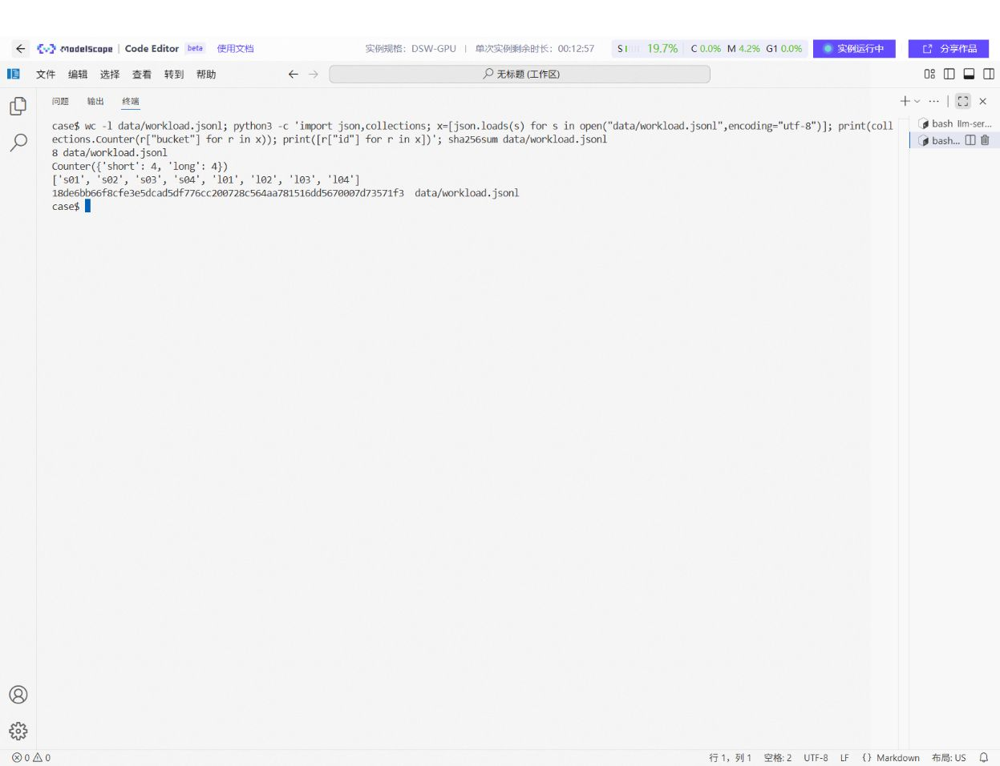
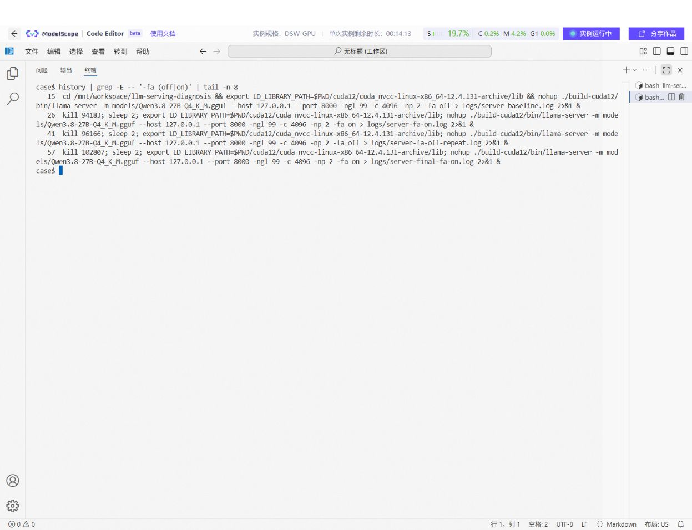
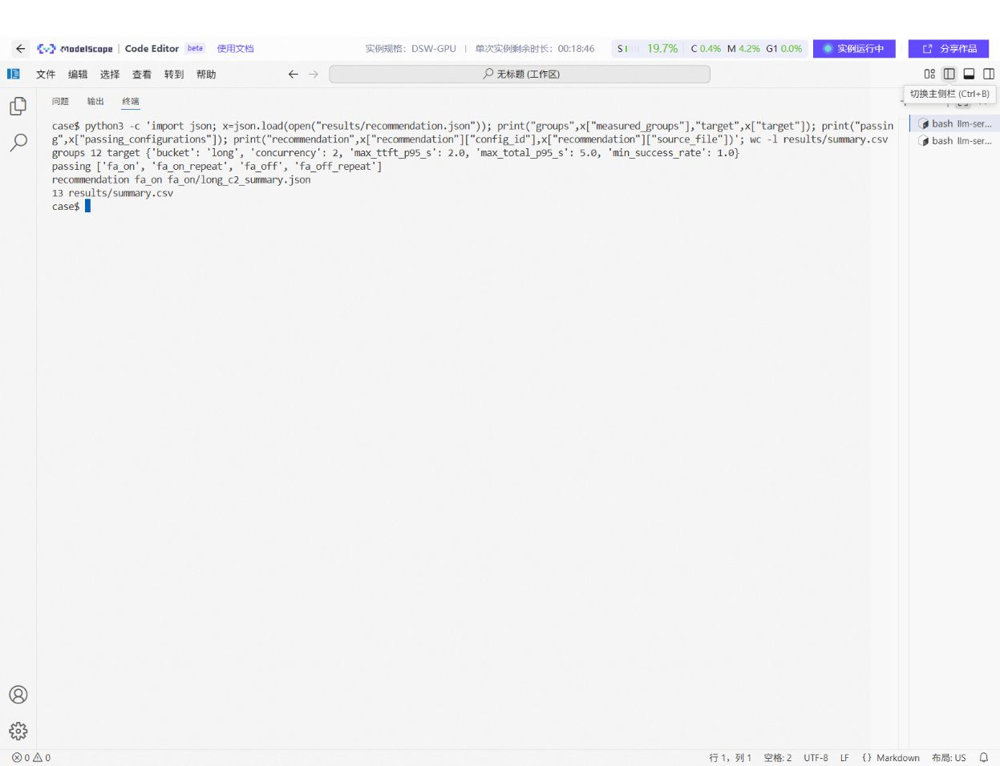

# 技术附录：单卡 24GB 部署 Qwen3.8-27B Q4 的性能对照

> 实测日期：2026-10-17。本文是魔搭 Notebook 的 NVIDIA A10 云端实测，不是手机、个人电脑或其他端侧硬件的性能实测。目标是给资源受限单卡部署提供一个可迁移的测量方法，不外推具体速度。

## 1. Case 基本信息

**一句话简介**：在单张 24GB A10 上部署固定的 Qwen3.8-27B Q4_K_M GGUF，用同一批公开中文部署问题和 llama.cpp 的 OpenAI 兼容接口，比较 Flash Attention 关闭与开启的首字延迟、吞吐、成功率和显存，再按事先设定的门槛选择配置。

- 适用对象：需要在单卡机器上部署和验收本地推理服务的工程师。
- 难度：进阶；首次复现预计 1-3 小时，主要取决于 16.8GB 模型下载、NFS 读取和 CUDA 编译。
- 运行方式：魔搭 GPU Notebook 的 Linux 终端；llama.cpp `b10430`；服务只监听 `127.0.0.1:8000`。
- 完成边界：HTTP 功能、固定负载的相对性能和错误请求处理。没有评判模型答案正确率，也没有验证其他显卡性能。

## 2. 场景与问题

实际部署时，模型“能加载”并不意味着并发用户的等待时间可接受。24GB 显存需要同时容纳约 16.8GB 的 Q4 权重、KV 缓存和计算缓冲。工程师需要在不更换权重的情况下回答：两路请求是否都成功；用户多久看到第一段输出；整体输出吞吐和显存如何变化。

本实验只改变 `-fa off/on`。输入是本目录 `data/workload.jsonl` 的 8 条人工编写、可公开的中文技术问题；4 条短问题、4 条较长问题。它们描述的是公开部署情境，不含客户日志或个人数据。长档问题**没有**真的填满 1600 个输入 token；问题中出现的“约 1600 token”是待分析场景文字，不能当成实测输入长度。
逐请求记录显示长档复测实际为约 `199-229` 个输入 token，`max_tokens=64` 时检查到的完成原因为 `length`。因此本次只衡量受限长度生成的服务性能，不把这些输出当成完整建议。

```text
公开 JSONL 问题 -> 固定参数的流式 HTTP 请求 -> llama-server/A10
       |                    |                        |
       |                    +-> 请求级 TTFT/总耗时/usage/错误
       +-> short/long 分类                +-> nvidia-smi 每秒采样
                              -> 分组 JSON/CSV -> 门槛验收与推荐
```

## 3. 前置准备

实测机器是魔搭 DSW-GPU Notebook，Linux x86_64，NVIDIA A10 24GB，驱动 `550.54.15`。实例预装 CUDA 13.0，曾无法用该版本初始化 GPU；本次 CUDA 12.4 方案实际跑通。`nvidia-smi` 报告的兼容能力不等于本地工具链版本。本次在项目目录组装 CUDA 12.4 工具链；版本为 NVCC `12.4.131`、CUDART `12.4.127`、cuBLAS `12.4.5.8`、CCCL `12.4.127`。Python 脚本只用标准库和 `nvidia-smi`；构建需要 Python 3、pip、CMake、C++ 编译器、make、aria2 和足够的磁盘空间（模型、源码、工具链与构建至少预留 35GB）。

模型来源：[Abiray/Qwen3.8-27B-Q4_K_M-GGUF](https://www.modelscope.cn/models/Abiray/Qwen3.8-27B-Q4_K_M-GGUF)，文件 `Qwen3.8-27B-Q4_K_M.gguf`，实际大小 `16,810,714,400` 字节，SHA256 `6a96cc760fc65cc6b9ea7f1922e3ff8b2a48c09f209456f23bbae9ef7032c867`。文件地址经 HTTP HEAD 验证返回 200，`X-Linked-Etag` 与 SHA256 一致。请在公开分发前再次核对模型仓库许可证。llama.cpp 源码来自官方 `b10430` 标签，源码包 SHA256 `c93fdbe93170b1cf93027e1a945c66a70bcdfbd272eeedbe8c90afe0a5d55e1`；源码使用其仓库许可证。

在全新 Notebook 的终端按顺序执行：

```bash
apt-get update
apt-get install -y aria2 cmake g++ make python3-pip git
cd /mnt/workspace
git clone https://github.com/qiyuefffs/llm-serving-diagnosis.git
cd /mnt/workspace/llm-serving-diagnosis/cases/llama-cpp-flash-attention
bash scripts/setup.sh
```

`setup.sh` 用 aria2 的 8 连接并发下载模型、官方源码和 NVIDIA CUDA 12.4 组件，检查模型与源码哈希，然后构建 `build-cuda12/bin/llama-server`。首次安装后若当前 Shell 找不到新工具，重开终端；Python 脚本本身不需要重启 Kernel。本次实际构建遇到缺少 CUDART/CCCL 头文件和链接器找不到 cuBLAS 的问题，脚本把对应头文件、库与 `rpath-link` 明确写入。不同 Notebook 镜像可能需要调整系统包安装权限。
这份 `setup.sh` 将本次成功执行的命令收拢为一键入口；尚未在第二个全新实例完整重跑，正式投稿前应做一次全新环境复现。

### 3.1 文件与目录

在魔搭工作区 `/mnt/workspace/` 执行 `git clone https://github.com/qiyuefffs/llm-serving-diagnosis.git`。进入 `cases/llama-cpp-flash-attention` 子目录后执行 `ls scripts data`，应看到四个脚本和 `workload.jsonl`。`setup.sh` 默认使用自身所在的 Case 目录，仍可由 `PROJECT` 覆盖。完整运行后的关键目录如下，源码、CUDA 工具链、缓存和权重占空间较大，不需要放进投稿仓库：

```text
cases/llama-cpp-flash-attention/
  CASE.md
  scripts/{setup.sh,smoke.py,bench.py,report.py}
  data/workload.jsonl
  models/Qwen3.8-27B-Q4_K_M.gguf       # setup.sh 下载
  cache/                               # 源码包与 CUDA 组件下载缓存
  cuda12/                              # 局部 CUDA 12.4 工具链
  llama.cpp-b10430/                    # 固定版本源码
  build-cuda12/bin/llama-server        # 编译产物
  logs/{build-cuda12.log,server-fa-off.log,server-fa-on.log}
  results/{smoke.json,summary.csv,recommendation.json,report.md}
  results/{fa_off,fa_on,fa_on_repeat,fa_off_repeat}/
```

工作负载文件每行一个 JSON 对象，包含 `id`、`bucket`、`prompt` 三个字段。`short` 和 `long` 各有四条，`bench.py` 在每组 8 或 20 次请求中按顺序循环取用。审核者可以先用以下命令确认公开输入的数量、标签及哈希：

```bash
wc -l data/workload.jsonl
python3 -c 'import json,collections; x=[json.loads(s) for s in open("data/workload.jsonl",encoding="utf-8")]; print(collections.Counter(r["bucket"] for r in x)); print([r["id"] for r in x])'
sha256sum data/workload.jsonl
```

预期是 8 行、`short: 4`、`long: 4`，输入哈希为 `18de6bb66f8cfe3e5dcad5df776cc200728c564aa781516dd5670007d73571f3`。这些问题由作者编写，代表真实部署验收任务的公开样例；不能宣称它们是生产请求或真实客户日志。

### 3.2 固定参数

| 项目 | 固定值 | 用途及边界 |
| --- | --- | --- |
| 模型 | `Qwen3.8-27B-Q4_K_M.gguf`，SHA256 如上 | 两配置使用同一权重文件 |
| 引擎 | llama.cpp `b10430`，CUDA 构建 | 避免版本差异影响对照 |
| 服务 | `127.0.0.1:8000`，`-ngl 99` | 全层 GPU 卸载，仅本机访问 |
| 上下文/槽位 | `-c 4096 -np 2` | 日志显示每槽 `2048` token |
| 唯一变量 | `-fa off` / `-fa on` | 比较 Flash Attention |
| 请求 | `temperature=0`，`seed=42`，`max_tokens=64`，流式 | 相同采样设置；输出可能截断 |
| 分组 | short/long，1/2 并发，各 8 请求；2 并发各 20 请求复测 | 不是压满显存的长上下文压测 |
| GPU 采样 | `nvidia-smi` 每秒一次 | 记录采样峰值，非瞬时峰值 |

默认 `bench.py` 的并发、请求数和输出上限与本 Case 不同，必须显式使用下文参数。所有客户端脚本从同一 Notebook 实例访问回环地址，不经公网。

## 4. 分步实战

以下命令都在 `/mnt/workspace/llm-serving-diagnosis/cases/llama-cpp-flash-attention` 执行。原始实验使用仓库根目录，历史截图保留旧路径；本次只整理目录，没有重新进行 GPU 测量。设置运行时库路径：

```bash
cd /mnt/workspace/llm-serving-diagnosis/cases/llama-cpp-flash-attention
export LD_LIBRARY_PATH="$PWD/cuda12/cuda_nvcc-linux-x86_64-12.4.131-archive/lib${LD_LIBRARY_PATH:+:$LD_LIBRARY_PATH}"
./build-cuda12/bin/llama-server --help >/dev/null
sha256sum models/Qwen3.8-27B-Q4_K_M.gguf
nvidia-smi
```

检查点：`--help` 成功退出、模型哈希与上文一致、`nvidia-smi` 识别 A10。不要把实例预装的 CUDA 13 库放在上面这个目录前面。

**步骤 0 的可见输出**：`sha256sum` 应显示上文的 64 位十六进制摘要；`nvidia-smi` 应列出 A10 和驱动版本。以 `./build-cuda12/bin/llama-server --help` 退出码 `0` 及后续实际加载为可执行产物检查。本次云端的 `logs/build-cuda12.log` 保留了早期一次编译失败，**不是成功构建证明**；修正构建后未保留单独的完整成功日志。本次环境校验截图见图 1；该截图是实验结束后在同一实例重做的只读校验。投稿前需在全新实例完整执行 `setup.sh` 并保留成功日志或截图。

### 步骤 1：加载基线

**目标**：先确认固定权重能装入 A10，且本地 API 就绪。启动前执行 `mkdir -p logs results`，并确认 8000 端口没有其他服务；如 `curl /health` 已返回旧服务，按步骤 4 的停服方式先停旧进程。

```bash
./build-cuda12/bin/llama-server \
  -m models/Qwen3.8-27B-Q4_K_M.gguf \
  --host 127.0.0.1 --port 8000 -ngl 99 -c 4096 -np 2 -fa off \
  > logs/server-fa-off.log 2>&1 &
SERVER_PID=$!
echo "$SERVER_PID" > logs/server.pid
until curl -fsS http://127.0.0.1:8000/health; do sleep 5; done
ps -p "$SERVER_PID" -o pid,args
tail -n 12 logs/server-fa-off.log
```

刚启动返回 `503 Loading model` 属于预期；待返回 `{"status":"ok"}` 再测试。实测首次从 NFS 工作区读取约 16.8GB 权重，约 3 分钟后就绪；冷加载时间不计入请求延迟。`nvidia-smi` 空闲显存约 16.1GB。`-c 4096` 是总上下文，`-np 2` 为两槽位，日志显示每槽 `n_ctx_slot = 2048`。输入加输出必须适配槽位长度。

若循环迟迟不结束，在另一个终端检查 `ps -p "$(cat logs/server.pid)"` 和 `tail -n 60 logs/server-fa-off.log`；进程已退出时停止等待并排错。日志需核对实际命令包含 `-fa off`，以及 `model loaded`、`listening on http://127.0.0.1:8000`。图 2 展示参数与健康检查，不用单独一张 `ok` 截图代替完整启动证据。

### 步骤 2：功能及边界检查

**目标**：证明 OpenAI 兼容接口能处理正常请求，也能识别畸形输入；这一步不计算进性能结果。

```bash
python scripts/smoke.py --output results/smoke.json
```

输出同时保存模型列表、正常请求和畸形请求的完整 HTTP 状态及响应。此次正常中文问题返回 `200`，耗时 `4.1286s`；`messages` 被故意设为字符串时返回 `400`，不是服务崩溃。正常请求输出不作为知识事实验证。若正常请求不是 200，先检查 `/health` 与服务日志；若畸形请求误返回 200，应视为异常处理未达标。

快速复查结构化证据：

```bash
python3 -c 'import json; x=json.load(open("results/smoke.json")); print("normal",x["valid_response"]["status"],"malformed",x["malformed_response"]["status"]); print("model",x["models"]["body"]["data"][0]["id"])'
```

图 3 应同时包含运行命令与两个状态码。`smoke.json` 保存响应正文，截图只作索引。

### 步骤 3：基线测量

**目标**：在权重已加载后保存 `off` 配置的逐请求延迟、完成 token 数及显存采样。正式测量前可以执行一次 `smoke.py` 作为服务预热，但不要把它记入 8/20 次组；本次实际先完成上述功能检查，再运行基线。

```bash
python scripts/bench.py --workload data/workload.jsonl --output results \
  --config-id fa_off --concurrency 1 2 --requests 8 --max-tokens 64
python scripts/bench.py --workload data/workload.jsonl --output results \
  --config-id fa_off_repeat --concurrency 2 --requests 20 --max-tokens 64
```

每个 `bucket x concurrency` 组合分别运行 8 次；复测为每档 20 次、2 并发。请求使用 `temperature=0`、`seed=42`、流式输出和相同的请求编号前缀。脚本保存逐请求 JSONL、每秒 GPU 采样 JSON、分组汇总 JSON 和配置元数据。请求编号变化是为了避免相同前缀缓存主导对照；两种配置的编号序列一致。

每条请求记录含 `request_id`、`prompt_id`、`status`、`success`、`ttft_s`、`total_s`、`prompt_tokens`、`completion_tokens`、`finish_reason`、`output_text` 和 `error`。例如目标组的证据路径是 `results/fa_off_repeat/long_c2.jsonl`、`long_c2_gpu.json`、`long_c2_summary.json`；`metadata.json` 记录模型、输入路径、并发和输出上限。检查 `summary.json` 的 `requests=20`、`successes=20`，并核对 JSONL 恰有 20 行。图 4 展示基线汇总；完整请求文本请看 JSONL，不应仅凭汇总判定无错误。

### 步骤 4：只开启 Flash Attention

停止前一进程后，仅将末尾 `-fa off` 改为 `-fa on`，其他服务参数、模型文件、输入和客户端命令保持一致。等 `/health` 返回 `ok` 再执行：

```bash
kill "$(cat logs/server.pid)"
while kill -0 "$(cat logs/server.pid)" 2>/dev/null; do sleep 1; done
./build-cuda12/bin/llama-server \
  -m models/Qwen3.8-27B-Q4_K_M.gguf \
  --host 127.0.0.1 --port 8000 -ngl 99 -c 4096 -np 2 -fa on \
  > logs/server-fa-on.log 2>&1 &
SERVER_PID=$!
echo "$SERVER_PID" > logs/server.pid
until curl -fsS http://127.0.0.1:8000/health; do sleep 5; done
ps -p "$SERVER_PID" -o pid,args
```

```bash
python scripts/bench.py --workload data/workload.jsonl --output results \
  --config-id fa_on --concurrency 1 2 --requests 8 --max-tokens 64
python scripts/bench.py --workload data/workload.jsonl --output results \
  --config-id fa_on_repeat --concurrency 2 --requests 20 --max-tokens 64
```

本次实际顺序为 off 8 次组 -> on 8 次组 -> on 20 次组 -> off 20 次组。不同顺序的运行有助于发现一次性的时序波动，但还不足以排除所有系统噪声。

为严格复现这个顺序，在 `on` 的 20 次组后，重复本步骤的停服命令，以步骤 1 的 `-fa off` 参数重新启动，再执行 `fa_off_repeat` 命令。上文步骤 3 把同一配置的两条客户端命令放在一起方便阅读，**实际采样顺序以本段为准**。不要在仍有旧服务监听 8000 端口时直接启动新进程；用 `ps` 和日志核对 `-fa on/off`。图 5 展示两种配置的启动参数；图 6 展示开启后的目标组汇总。首次加载时间不纳入请求组统计。

### 步骤 5：报告与验收

**目标**：只从已保存的 `_summary.json` 生成 12 组对照与推荐，不让模型自行判断“更快”。

```bash
python scripts/report.py results --bucket long --concurrency 2 \
  --max-ttft-p95-s 2 --max-total-p95-s 5 --min-success-rate 1
```

预设目标是长档两并发请求成功率 100%、TTFT P95 不超过 2 秒、总耗时 P95 不超过 5 秒。产物为 `results/summary.csv`、`results/recommendation.json` 和 `results/report.md`。脚本只从实测 JSON 汇总中筛选，不预测未测配置。本次四种配置均过门槛；按 TTFT P95 最小排序，报告推荐 `fa_on` 的 8 次组。

```bash
cat results/recommendation.json
sed -n '1,24p' results/report.md
wc -l results/summary.csv
```

正常应有 12 个实测分组，含表头的 CSV 共 13 行。`recommendation.json` 的 `source_file` 可追到对应配置的 `_summary.json`，再由同名 JSONL 查到每个请求。若没有配置过门槛，脚本会报告 `none passed`，不能自行挑一项指标改写结论。图 7 展示报告产物。

### 证据截图与图注

以下画面均取自本次魔搭实例的终端，图片文件保存在公开仓库的 `figures/`。图 0、1、2、3、4、5、6、7 是在实验结束后对已有输入、日志和结果进行的核验截图，**不是声称在截图时重新完成模型下载、编译或整轮基准测试**。命令行中的 `case$` 是为了隐藏临时实例主机名设置的提示符，未修改测量脚本或结果文件。图片只展示可读摘要；可复查的原始文件仍以 `results/`、`logs/` 为准。原始逐请求结果暂未公开。



*图 0. 输入文件核验。关注 8 行、两类各 4 条及哈希；内容见 `data/workload.jsonl`。*


*图 1. 环境与权重校验。显示 A10 24564 MiB、驱动 550.54.15、`llama-server --help` 成功及权重哈希。该图是命令完成后的终端状态，命令本身见步骤 0。*


*图 2. 优化配置运行状态。`ps` 中可核对 `-fa on -c 4096 -np 2`，`/health` 为 `ok`，日志显示两槽、每槽 2048 token 和本机监听。基线参数见图 5 的历史命令。*


*图 3. 功能与异常验收。终端从 `results/smoke.json` 读取状态码；响应正文和原始请求在该 JSON 文件中。*


*图 4. 基线复测。`20/20` 成功，TTFT P95 为 `1.7893s`，输出吞吐 `26.8582 token/s`；对应请求级文件为 `results/fa_off_repeat/long_c2.jsonl`。*



*图 5. 配置切换记录。Shell 历史列出两种启动参数及重复顺序；它仅辅助核对命令，不替代各组元数据、服务日志和结果文件。*


*图 6. 优化复测。`20/20` 成功，TTFT P95 为 `1.5740s`，输出吞吐 `28.1866 token/s`；与图 4 按同一组定义对照。*



*图 7. 自动验收报告。12 组、4 个目标配置过门槛，推荐 `fa_on` 首轮目标组，并指向对应 `_summary.json`；含表头 CSV 共 13 行。*

## 5. 完整运行结果

以下是云端原始分组汇总中的目标工作负载。完整 12 组结果已转录至 `results/observed-summary.csv`；云端逐请求文件在 `results/<配置>/long_c2.jsonl`，对应 GPU 采样在 `long_c2_gpu.json`。`observed-summary.csv` 是从终端实测输出转录的便于离线阅读的副本，不冒充原始请求记录。

| 轮次 | 配置 | 长档并发 2 | TTFT P95 | 总耗时 P95 | 输出 token/s | 峰值显存 |
| --- | --- | ---: | ---: | ---: | ---: | ---: |
| 首轮 | off | 8/8 成功 | 1.7796s | 4.845s | 27.1245 | 16111 MiB |
| 首轮 | on | 8/8 成功 | 1.5469s | 4.6099s | 28.4047 | 16063 MiB |
| 复测 | off | 20/20 成功 | 1.7893s | 4.8071s | 26.8582 | 16111 MiB |
| 复测 | on | 20/20 成功 | 1.5740s | 4.5937s | 28.1866 | 16063 MiB |

复测中 TTFT P95 下降 `0.2153s`（约 `12.0%`），输出吞吐提高约 `4.9%`，采样到的显存峰值低 `48 MiB`。这些是这台 A10、这组短输出样本的观测值，不是保证的加速比。短档复测也显示 TTFT P95 从 `1.4179s` 降至 `1.2611s`。两轮方向一致，但样本规模仍小，不能据此声称统计显著或更长上下文必然获益。

## 6. 评测口径与验收

- `TTFT`：客户端发出 HTTP 请求到收到首个非空流式 `content` 或 `reasoning_content` 的时间，包含本机 HTTP 和服务排队。对于会输出推理文本的模型，它不是“最终答案首字”的时间。
- `总耗时`：客户端发请求到流完成。`P95` 用最近秩法，8 个样本时等于第 8 大值，因此特别容易受单个慢请求影响。
- `输出 token/s`：同组成功请求的服务端 `usage.completion_tokens` 总数除以该组墙钟耗时；如 usage 缺失，脚本尝试 `/tokenize`，再缺失则标注空值。
- `峰值显存`：`nvidia-smi` 每秒取样，可能漏掉亚秒级峰值。
- 功能验收：`/health` 是 `ok`，正常请求 200 且出现非空流，逐请求成功数等于请求数，畸形请求返回 4xx，所有 JSON/CSV/Markdown 文件生成。
- 质量验收：本 Case 的质量目标是服务延迟与吞吐，不对模型内容作准确率结论。64 token 上限可能截断技术建议；业务内容质量需要另设人工或自动测试。
- 安全边界：服务仅绑定 `127.0.0.1`。llama-server 启动日志提示默认 CORS `*` 且未设置 API key；因此不应把本命令的服务端口直接对外暴露。需要远程访问时另设计身份认证和网络隔离。

## 7. 已知限制与排错

1. **驱动和 CUDA 不匹配**：本机驱动最高支持 CUDA 12.4，实例自带 CUDA 13 路径不适用。检查 `nvidia-smi` 和 `nvcc --version`，按 `setup.sh` 使用局部 CUDA 12.4 并设置运行库路径。
2. **启动后一直 503**：先看 `logs/server-*.log` 和 `ps`。此次模型位于 NFS，首次载入慢；确认文件大小与 SHA256，等日志出现 `model loaded` 再请求。
3. **显存不足**：降低 `-c`、`-np` 或 GPU 卸载层数后重新测量，不能沿用本 Case 的指标。24GB 是本次 A10 的硬件容量，不保证其他 24GB 卡结果相同。
4. **适用范围**：输入问题是人工编写的公开部署场景，非真实客户流量；最多两路并发、最多 64 输出 token，不代表长上下文、长生成或多用户生产负载。两次运行仍受 GPU 时钟、温度、实例邻居和 NFS 缓存影响。
5. **复现误差**：同哈希模型、同代码、同硬件仍可能得到不同延迟。复核时先看成功率和趋势，再对比每个原始 JSONL 与 GPU 采样，不应只对比一个汇总数字。

## 8. 代码、数据和证据

- 完整脚本：`scripts/setup.sh`、`scripts/bench.py`、`scripts/smoke.py`、`scripts/report.py`；公开输入：`data/workload.jsonl`（SHA256 `18de6bb66f8cfe3e5dcad5df776cc200728c564aa781516dd5670007d73571f3`）。
- 云端工作目录：`/mnt/workspace/llm-serving-diagnosis`；原始证据：`results/`、`logs/`、`environment/model.sha256`；云端打包文件：`case-evidence.tar.gz`。公开仓库的 `figures/` 保存 8 张终端核验截图。魔搭实例有时效，绝对路径不是永久公共链接。
- 模型：[魔搭模型页](https://www.modelscope.cn/models/Abiray/Qwen3.8-27B-Q4_K_M-GGUF)；推理引擎：[llama.cpp b10430](https://github.com/ggml-org/llama.cpp/tree/b10430)；CUDA 组件来自 [NVIDIA 官方分发目录](https://developer.download.nvidia.com/compute/cuda/redist/) 与 PyPI 的 `nvidia-*` 包。

**公开投稿状态**：实测、脚本、文字链路及核验截图已完成并放入公开仓库。本次成功构建过程缺少完整终端日志或当时的截图，`setup.sh` 也尚未在第二个全新实例从头重跑。当前魔搭网页 IDE 的文件“下载”操作未向浏览器提供可取得的下载产物；因此公开仓库只有汇总转录与截图，云端保存完整逐请求 JSONL、GPU 采样和日志。正式向社区提交前，仍需在全新实例验证一键构建，把脱敏后的原始证据放入公开仓库或可长期访问的存储。不能把当前临时云端路径写成公开证据链接。
