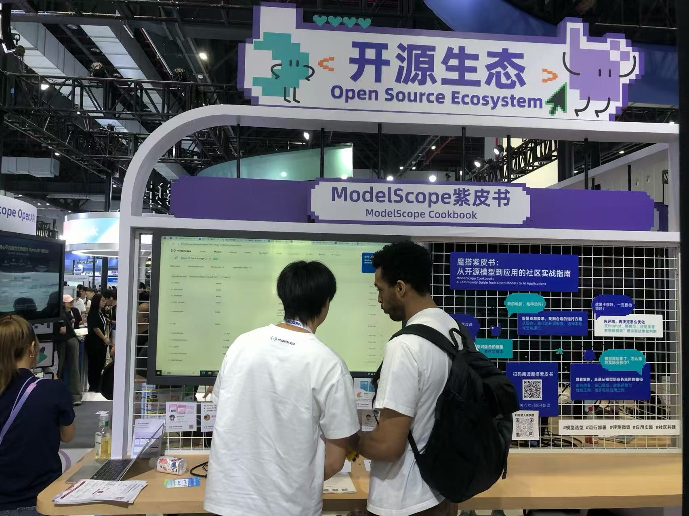
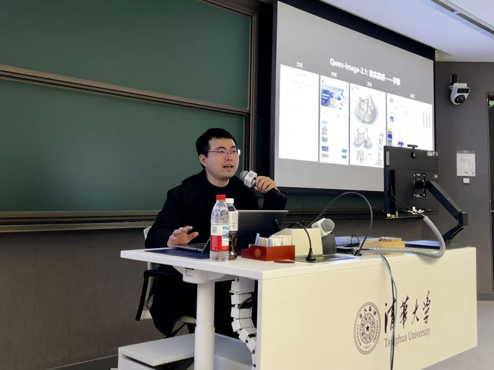
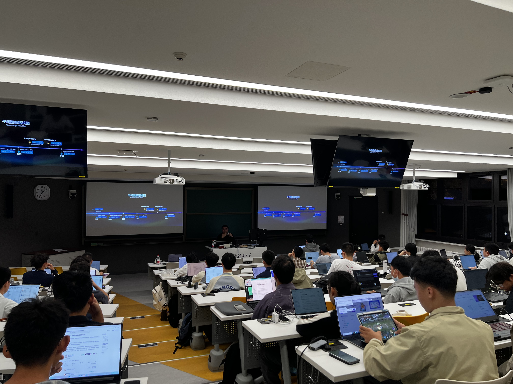
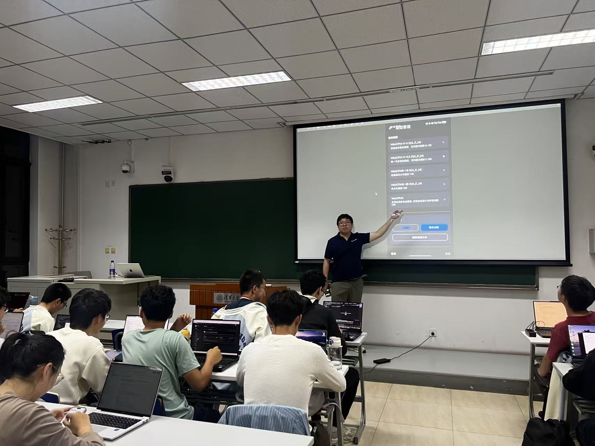
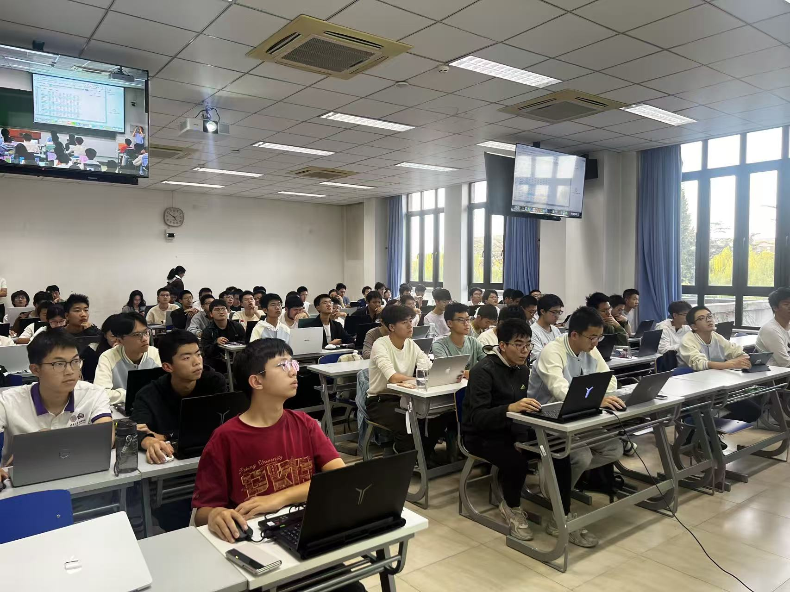

# 共建活动时间线

[在线查看时间线](https://modelscope.cn/studios/ms-cookbook-team/ms-cookbook) · [返回项目首页](../../README.md)

## 2026-11-04 · 线上共学营

### 魔搭紫皮书共学营 Vol 4：小模型也能搞科研？4B参数也玩起了科学发现～用Qwen3搭建Mini AIScientist全流程，从提出假设到验证结论

直播时间：2026 年11 月 4 日 晚 7 点

<strong>面向人群：</strong>想用开源模型搭建 Agent、探索 AI 科研与推理评测的朋友。

<strong>主讲人：</strong>包启明，AI Research Scientist&amp;Engineer@Xtracta，魔搭社区共建者 ；

直播内容：

<ul><li>给 AI 一台黑盒机器，它能找出隐藏规律吗</li></ul>

<ul><li>提假设、做实验、验结果，搭建最小科研闭环</li></ul>

<ul><li>模型更大，还是多想一会儿，谁更管用</li></ul>

<ul><li>结论和实验数据矛盾，Agent 该怎么改</li></ul>

<ul><li>AI 说“发现了”，怎样验证它真的找对了</li></ul>

---

## 2026-10-28 · 线上共学营

### 魔搭紫皮书共学营·AIGC 专场：从出图、改图到做漫剧：魔搭紫皮书 AIGC 解读与实战

直播时间： 2026 年10 月 28 日周三晚 8 点

主讲人：

刘聪 NLP，自媒体博主（全网ID-刘聪NLP），魔搭社区共建者，曾任某头部AI独角兽公司大模型算法专家

啊 ban，AIGC 特异点频道的主理人， 独立开发者，魔搭社区共建者

<strong>直播内容：</strong>

<ul><li><strong>开源生图能力实测</strong>：文字、数量、构图，模型到底听懂了多少</li></ul>

<ul><li><strong>LoRA 形象定制</strong>：如何定制属于自己的固定形象</li></ul>

<ul><li><strong>商品营销图实战</strong>：一张商品图，从生成、修改到交稿检查</li></ul>

<ul><li><strong>漫改短剧经验拆解</strong>：漫改短剧经验拆解：制作流程与关键步骤详解</li></ul>

直播回放：<a href="https://www.bilibili.com/video/BV1fJxY6ZEej/?spm_id_from=333.1365.list.card_archive.click&amp;vd_source=dfb9e28d9cc8b4a4fba718e7eb0e09f0" target="_blank" rel="noopener noreferrer">https://www.bilibili.com/video/BV1fJxY6ZEej/?spm_id_from=333.1365.list.card_archive.click&amp;vd_source=dfb9e28d9cc8b4a4fba718e7eb0e09f0</a>

---

## 2026-10-21 · 线上共学营

### 魔搭紫皮书共学营·进阶实践：模型跑通了，怎么变好用？  选型、评测、微调与企业知识问答实战

直播时间：2026 年10 月 21 日（周三）晚 8 点

主讲人：

<ul><li>刘聪 NLP，自媒体博主（全网ID-刘聪NLP），魔搭社区共建者，曾任某头部AI独角兽公司大模型算法专家</li></ul>

<ul><li>甲木，自媒体博主（全网ID「甲木未来派」），魔搭社区共建者，</li></ul>

面向人群：跑过模型、会基本 Python，准备把模型用进真实业务的朋友。

直播内容：

<ul><li>开源模型怎样走进真实业务</li></ul>

<ul><li>需求怎么拆，模型怎么选</li></ul>

<ul><li>榜单之外，给模型做次体检</li></ul>

<ul><li>用 ms-swift 教模型按要求做事</li></ul>

<ul><li>让企业助手先查资料再回答</li></ul>

直播回放：<a href="https://www.bilibili.com/video/BV18wn16wENC/?spm_id_from=333.1387.list.card_archive.click" target="_blank" rel="noopener noreferrer">https://www.bilibili.com/video/BV18wn16wENC/?spm\_id\_from=333.1387.list.card\_archive.click</a>

---

## 2026-10-21 至 2026-10-23 · 展出

### 魔搭紫皮书登录 2026 云栖大会展出

时间：2026 年 10 月 21 日-23 日

---

## 2026-10-16 · 线下工作坊

### 工作坊：魔搭× Qwen-Image ：面向生产力的图像生成基础模型——技术解析与实践

<strong>主讲人：</strong>吴晨飞 Qwen-Image负责人、魔搭社区共建者

地点：清华大学五教5101

时间：2026 年 10 月 16 日周五 19:00-21:00

简介：一张图像是怎样生成出来的？模型如何理解提示词、准确画出中文，并在修改画面时保持主体一致？如何亲手运行开源模型，优化出图效果与推理速度，再把它用于自己的创作项目？

本工作坊由魔搭社区联合 Qwen Image 团队共同推出，将从图像生成模型的核心架构与训练思路出发，解析模型如何理解提示词、生成图像中的文字，以及在编辑过程中兼顾语义修改与主体一致性。结合魔搭 AIGC 专区已上线的 Qwen Image 2.1，进一步探讨生成参数、推理加速与显存优化如何影响速度和画面质量，并通过具体案例展示从模型能力到实际工作流的实现过程。 工作坊配套双方共建的《魔搭紫皮书》 完整实践教程，帮助同学们从原理理解走向代码复现，在魔搭 Notebook 中开展参数实验、效果对比与性能分析，并通过创空间构建自己的图像生成应用，并配套线上答疑共学群，支持后续的持续学习和实践。

---

## 2026-10-15 · 线上共学营

### 魔搭紫皮书共学营·小白入门：开源模型，原来可以这么玩！  从第一次运行，到语音助手体验

直播时间：2026 年10 月 15 日 周四晚 8 点

主讲人：

<ul><li>刘聪 NLP，自媒体博主（全网ID-刘聪NLP），魔搭社区共建者，曾任某头部AI独角兽公司大模型算法专家</li></ul>

<ul><li>甲木，自媒体博主（全网ID「甲木未来派」），魔搭社区共建者，</li></ul>

面向人群：刚接触开源模型，想动手试一试的朋友。

直播内容：

<ul><li>开源模型正在改变什么</li></ul>

<ul><li>模型去哪找，算力怎么借</li></ul>

<ul><li>一段录音，跑出第一个结果</li></ul>

<ul><li>CPU、GPU 与量化，轻松聊明白</li></ul>

<ul><li>让 AI 能听，也能开口回答</li></ul>

直播回放：<a href="https://www.bilibili.com/video/BV1AqJQ6BE46/?spm_id_from=333.1387.list.card_archive.click&amp;vd_source=dfb9e28d9cc8b4a4fba718e7eb0e09f0" target="_blank" rel="noopener noreferrer">https://www.bilibili.com/video/BV1AqJQ6BE46/?spm_id_from=333.1387.list.card_archive.click&amp;vd_source=dfb9e28d9cc8b4a4fba718e7eb0e09f0</a>

---

## 2026-10-15 · 线下工作坊

### 工作坊：魔搭 X面壁 MiniCPM  ：端侧大模型的训练解析与手机部署实践

主讲人：杨知铮 OpenBMB 开源社区开发者关系负责人、魔搭社区共建者

地点：清华大学1015 新水利馆325

时间：2026 年10 月 15 日 周四16:30-18:30

简介：一个小模型是怎样训练出来的？如何亲手微调它，再让它在自己的手机上完成实际任务？ 本次工作坊由魔搭社区联合面壁智能共同推出，从 MiniCPM 的模型架构与训练思路出发，解析小模型如何在有限的参数与计算资源下提升能力，以及量化、内存占用与推理速度之间的取舍。同学们将在魔搭 Notebook 中完成一次轻量微调，对比训练前后的效果，将模型上传魔搭社区，并部署到受支持的个人手机上，探索从模型训练到端侧应用的完整过程。 工作坊配套双方共建的《魔搭紫皮书》完整实践教程，支持同学们课后继续复现、优化和开发自己的手机 AI 应用，并配套线上答疑共学群。

---
